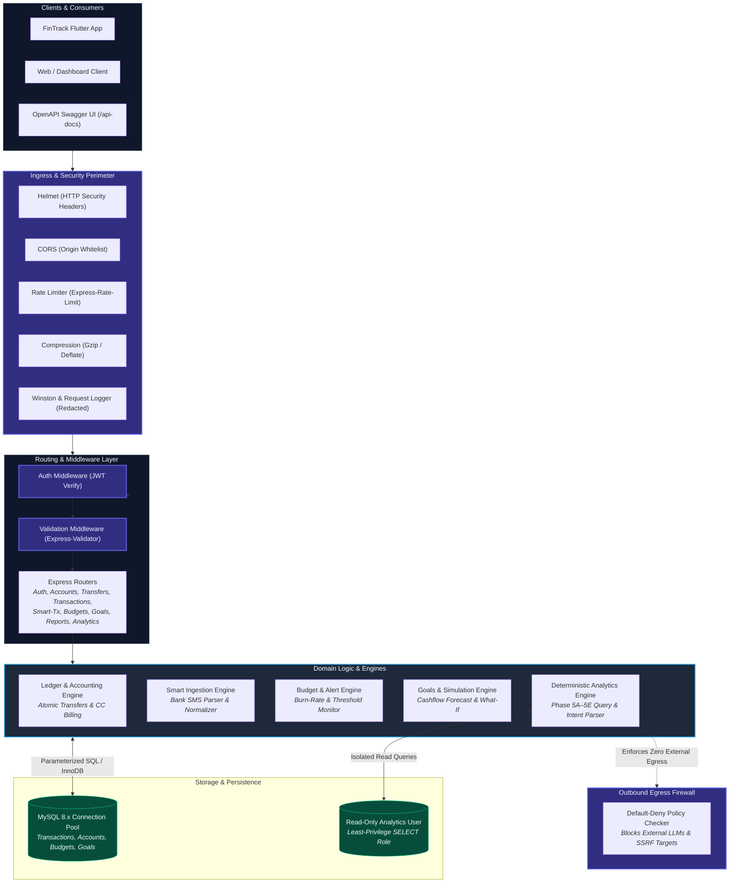
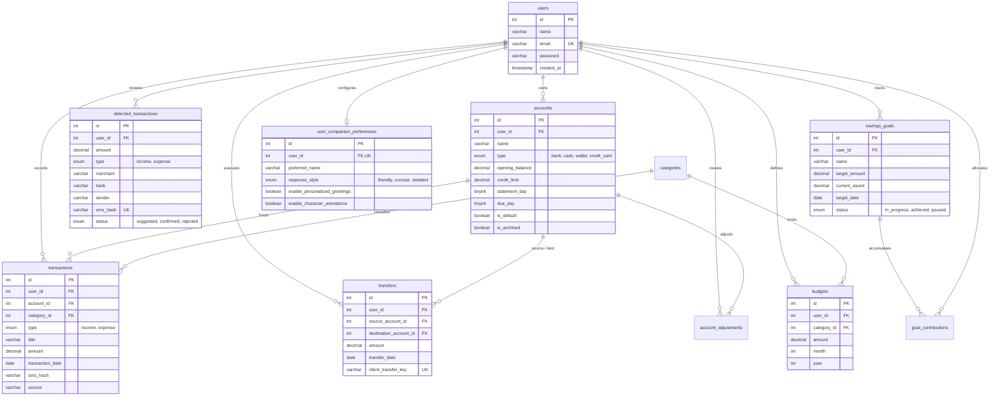

<p align="center">
  
</p>

<p align="center">
  
</p>

<h1 align="center">FinTrack 2.0 Backend REST API</h1>

<p align="center">
  <strong>Production-Grade Financial Ledger, Deterministic Analytics & Privacy Egress Firewall</strong><br>
  <em>A high-performance Node.js / Express 5.x service backed by MySQL 8.x, powering multi-tenant accounting, smart SMS transaction ingestion, proactive budgeting, and the FIN Financial Intelligence Companion.</em>
</p>

<p align="center">
  
  
  
  
  
  
</p>

<p align="center">
  <a href="#-overview">Overview</a> •
  <a href="#-architecture">Architecture</a> •
  <a href="#-api-reference">API Reference</a> •
  <a href="#-database-architecture">Database Schema</a> •
  <a href="#-security--privacy-architecture">Security & Privacy</a> •
  <a href="#-environment-setup">Environment Setup</a> •
  <a href="#-deployment-guide">Deployment</a> •
  <a href="#-testing">Testing</a>
</p>

---

## 🏛️ Overview

The **FinTrack 2.0 Backend REST API** serves as the authoritative transactional core and intelligence engine for the FinTrack personal finance ecosystem. It is designed around principles of financial precision, tenant isolation, and strict data privacy.

### Core Responsibilities

1. **Multi-Tenant Double-Entry Ledger**: Handles asset accounts (Bank, Cash, Wallets), liability accounts (Credit Cards with statement cycles), atomic transfers, and auditable manual balance adjustments.
2. **Deterministic Minor-Unit Arithmetic**: Prevents IEEE 754 floating-point rounding errors across all monetary transactions, budget allowances, and savings contributions.
3. **Smart Transaction Detection (Phase 3B)**: Parses unstructured SMS payloads into structured transaction candidates, normalizes Indian and international merchant entities, performs automated category matching, and enforces staged review (`suggested` → `confirmed` / `rejected`).
4. **Living Budgets & Smart Alerts (Phase 3A / 5C)**: Real-time budget progress calculation, daily burn-rate run rates, chronological comparison, 3-month rolling average recommendations, and proactive threshold alerts.
5. **Deterministic Intelligence & FIN Companion (Phase 5A–5E)**: Powers conversational queries for the **FIN** companion using parameterized SQL queries and controlled templates. **No raw financial data is ever transmitted to external AI providers.**
6. **Default-Deny Egress Firewall**: Guarantees zero unauthorized outbound network requests from the analytics and accounting engines.

---

## 🏗️ Architecture

The backend application is structured as a modular Express 5.x service emphasizing separation of concerns, strict input validation, and secure database connection pooling.



### Key Architectural Invariants

- **Express 5.x Native Promise Resolution**: Route handlers use `asyncHandler` wrappers to route asynchronous errors directly into the centralized error handling pipeline without unhandled promise rejections.
- **Connection Pooling**: Uses `mysql2/promise` with configurable pool limits (`connectionLimit: 10`), automatic connection recycling, and graceful termination handling upon `SIGINT` / `SIGTERM`.
- **Tenant Isolation**: Every database access path incorporates parameterized `WHERE user_id = ?` clauses. Client-supplied user identifiers in request bodies are ignored.
- **Fail-Closed Privacy Check**: Application startup verifies outbound policy (`assertNoProhibitedProvidersConfigured`). Detection of unauthorized external LLM API keys for sensitive analytics immediately aborts initialization.

---

## 📡 API Reference

Interactive API documentation and schema exploration is available locally at:
👉 **`http://localhost:5000/api-docs`** (Swagger UI / OpenAPI 3.0)

### 1. Authentication & Identity (`/api/auth`)

| Method | Endpoint | Auth | Description |
| :--- | :--- | :---: | :--- |
| `POST` | `/api/auth/register` | None | Create new user account with bcrypt password hashing (rounds: 10). |
| `POST` | `/api/auth/login` | None | Authenticate credentials; sets signed HTTP-only cookie and returns JWT token. |
| `POST` | `/api/auth/logout` | Optional | Clear session cookie and invalidate active client state. |
| `GET` | `/api/auth/me` | Bearer | Retrieve authenticated profile (`id`, `name`, `email`, `created_at`). |
| `PUT` | `/api/auth/me` | Bearer | Update user display name (email remains read-only pending verification). |
| `PUT` | `/api/auth/password` | Bearer | Change password with current password verification and immediate JWT session invalidation. |
| `DELETE` | `/api/auth/me` | Bearer | Transactional account deletion with password re-verification and cascading data cleanup. |
| `GET` | `/account-deletion/` | None | External public deletion interface for store compliance. |

### 2. Accounts & Wallets (`/api/accounts`)

| Method | Endpoint | Auth | Description |
| :--- | :--- | :---: | :--- |
| `POST` | `/api/accounts` | Bearer | Create asset account (Bank, Cash, Digital Wallet) with opening balance. |
| `POST` | `/api/accounts/credit-card` | Bearer | Create credit card account with credit limit, statement day, and payment due day. |
| `GET` | `/api/accounts` | Bearer | List accounts with ledger-computed live balances, active counts, and types. |
| `GET` | `/api/accounts/:id` | Bearer | Get specific account details and calculated balance breakdown. |
| `PUT` | `/api/accounts/:id` | Bearer | Update account name, type, icon, or metadata. |
| `PUT` | `/api/accounts/:id/default` | Bearer | Set primary default account for transaction recording. |
| `PUT` | `/api/accounts/:id/archive` | Bearer | Soft-archive account (enforces zero-balance prerequisite). |
| `GET` | `/api/accounts/:id/balance` | Bearer | Query ledger balance breakdown (opening + credits - debits + adjustments). |
| `GET` | `/api/accounts/:id/activity` | Bearer | Get combined timeline of transactions, transfers, and adjustments. |
| `POST` | `/api/accounts/:id/adjustments` | Bearer | Record auditable manual balance adjustment with explicit reason. |
| `GET` | `/api/accounts/:id/adjustments` | Bearer | List historical adjustments for reconciliation auditing. |
| `GET` | `/api/accounts/:id/credit-card` | Bearer | Get billing cycle status, outstanding debt, and available credit limit. |
| `PUT` | `/api/accounts/:id/billing` | Bearer | Update credit card statement closing day (1-31) and payment due day (1-31). |
| `POST` | `/api/accounts/:id/repay` | Bearer | Record credit card repayment sourced from a bank or wallet account. |
| `GET` | `/api/accounts/:id/payments` | Bearer | Retrieve repayment history for a credit card account. |

### 3. Fund Transfers (`/api/transfers`)

| Method | Endpoint | Auth | Description |
| :--- | :--- | :---: | :--- |
| `POST` | `/api/transfers` | Bearer | Execute atomic transfer between two accounts with client deduplication keys. |
| `GET` | `/api/transfers` | Bearer | List transfer history with pagination and source/destination filtering. |
| `GET` | `/api/transfers/:id` | Bearer | Retrieve individual transfer record and participant accounts. |

### 4. Transactions Ledger (`/api/transactions`)

| Method | Endpoint | Auth | Description |
| :--- | :--- | :---: | :--- |
| `POST` | `/api/transactions` | Bearer | Record new income or expense transaction linked to a category and account. |
| `GET` | `/api/transactions` | Bearer | List transactions with search filter, date range, category, and pagination. |
| `GET` | `/api/transactions/imported-hashes` | Bearer | Retrieve list of imported SMS hashes to avoid duplicate mobile uploads. |
| `POST` | `/api/transactions/import-sms` | Bearer | Batch import transactions from SMS with SHA-256 hash collision guards. |
| `GET` | `/api/transactions/:id` | Bearer | Retrieve individual transaction record details. |
| `PUT` | `/api/transactions/:id` | Bearer | Update transaction amount, category, date, account, or notes. |
| `DELETE` | `/api/transactions/:id` | Bearer | Remove transaction from ledger (automatically updates account balances). |

### 5. Smart SMS Staging & Review (`/api/smart-transactions`)

| Method | Endpoint | Auth | Description |
| :--- | :--- | :---: | :--- |
| `POST` | `/api/smart-transactions/detect` | Bearer | Ingest raw SMS batch; parse bank format; match merchant; stage as `suggested`. |
| `GET` | `/api/smart-transactions` | Bearer | List detected transactions filtered by status (`suggested`, `confirmed`, `rejected`). |
| `GET` | `/api/smart-transactions/:id` | Bearer | Get single detected transaction detail. |
| `PUT` | `/api/smart-transactions/:id` | Bearer | Edit detected transaction properties before committing. |
| `POST` | `/api/smart-transactions/:id/confirm` | Bearer | Atomically promote candidate into verified `transactions` ledger. |
| `POST` | `/api/smart-transactions/:id/reject` | Bearer | Reject candidate with audit reason without touching transaction ledger. |
| `POST` | `/api/smart-transactions/batch/confirm` | Bearer | Batch confirm multiple detected transactions in an atomic transaction. |
| `POST` | `/api/smart-transactions/batch/reject` | Bearer | Batch reject candidates with reason logging. |

### 6. Living Budgets & Burn Rate (`/api/budgets`)

| Method | Endpoint | Auth | Description |
| :--- | :--- | :---: | :--- |
| `POST` | `/api/budgets` | Bearer | Create category budget cap for a specific month and year. |
| `GET` | `/api/budgets` | Bearer | List active budget caps for requested month and year. |
| `GET` | `/api/budgets/status` | Bearer | Overall monthly budget status and total category breakdown. |
| `GET` | `/api/budgets/progress` | Bearer | Real-time category spending vs limits, utilization %, and overrun flags. |
| `GET` | `/api/budgets/alerts` | Bearer | Threshold evaluation (`on_track`, `approaching_limit` at 80%, `exceeded` at 100%). |
| `GET` | `/api/budgets/suggestions` | Bearer | Deterministic 3-month rolling average spending recommendations. |
| `GET` | `/api/budgets/history` | Bearer | Historical budget vs actual performance across prior months. |
| `GET` | `/api/budgets/savings-target` | Bearer | Evaluate net savings progress against configured target goals. |
| `GET` | `/api/budgets/:id` | Bearer | Get specific budget record details. |
| `PUT` | `/api/budgets/:id` | Bearer | Update monthly budget cap amount. |
| `DELETE` | `/api/budgets/:id` | Bearer | Delete category budget. |

### 7. Financial Planning & Savings Goals (`/api/goals`)

| Method | Endpoint | Auth | Description |
| :--- | :--- | :---: | :--- |
| `POST` | `/api/goals` | Bearer | Create a new savings goal with target amount, category, and target deadline. |
| `GET` | `/api/goals` | Bearer | List goals with progress percentage, remaining amounts, and estimated completion. |
| `GET` | `/api/goals/summary` | Bearer | High-level summary of active, completed, and total savings tracked. |
| `GET` | `/api/goals/forecast` | Bearer | Deterministic cashflow forecast and savings capacity projection. |
| `POST` | `/api/goals/simulate` | Bearer | Run what-if simulation (e.g. cut expenses by X%, increase savings by Y). |
| `GET` | `/api/goals/:id` | Bearer | Goal details with full contribution ledger. |
| `PUT` | `/api/goals/:id` | Bearer | Update goal parameters (target amount, deadline, priority). |
| `DELETE` | `/api/goals/:id` | Bearer | Delete goal and associated contribution records. |
| `POST` | `/api/goals/:id/contributions` | Bearer | Record manual savings contribution without mutating bank transactions. |
| `GET` | `/api/goals/:id/contributions` | Bearer | List contribution entries for a specific goal. |

### 8. Deterministic Analytics & FIN Companion (`/api/analytics`)

| Method | Endpoint | Auth | Description |
| :--- | :--- | :---: | :--- |
| `GET` | `/api/analytics/capabilities` | Bearer | List allowlisted FIN assistant capabilities and privacy invariants. |
| `POST` | `/api/analytics/query` | Bearer | Process natural language financial question with safe intent parser & templates. |
| `GET` | `/api/analytics/insights` | Bearer | Retrieve deterministic multi-dimension observations for current period. |
| `GET` | `/api/analytics/alerts` | Bearer | Fetch proactive financial intelligence notifications and anomaly warnings. |
| `GET` | `/api/analytics/companion/preferences` | Bearer | Get companion settings (preferred name, response style, animations). |
| `PUT` | `/api/analytics/companion/preferences` | Bearer | Update companion response style, name, and focus goals. |
| `DELETE` | `/api/analytics/companion/preferences` | Bearer | Reset companion personalization to factory defaults. |
| `POST` | `/api/analytics/companion/action/confirm` | Bearer | Execute an authorized application action (e.g. goal creation) with parameter validation. |

### 9. Reports & Cashflow (`/api/reports`)

| Method | Endpoint | Auth | Description |
| :--- | :--- | :---: | :--- |
| `GET` | `/api/reports/summary` | Bearer | Period cashflow summary: total income, total expense, net balance, savings rate. |
| `GET` | `/api/reports/monthly` | Bearer | Monthly grouped aggregation of income vs expenses. |
| `GET` | `/api/reports/category` | Bearer | Category-wise expense and income totals with percentage shares. |
| `GET` | `/api/reports/trends` | Bearer | Comparative trend analysis across consecutive periods. |
| `GET` | `/api/reports/cashflow` | Bearer | Detailed chronological ledger entries with running balance calculations. |
| `GET` | `/api/reports/export` | Bearer | Structured dataset export for reporting and analysis. |

### 10. Dashboard & System Health

| Method | Endpoint | Auth | Description |
| :--- | :--- | :---: | :--- |
| `GET` | `/api/dashboard` | Bearer | Aggregated overview: Net worth, monthly cashflow, category breakdown, recent activity. |
| `GET` | `/health` | None | Service liveness and database connection ping (`SELECT 1`). |
| `GET` | `/` | None | Root status indicator verifying API availability. |

---

## 🗄️ Database Architecture

The FinTrack database utilizes **MySQL 8.x** with the **InnoDB** storage engine. All foreign key constraints enforce referential integrity with cascading deletions scoped per user.

### Entity Relationship Diagram



### Migration Execution Sequence

Database migrations reside in `migrations/` and must be executed in numeric sequence against a fresh MySQL database:

1. `0001_reconstructed_development_baseline.sql`: Core users, categories, transactions, budgets, and migration tracking.
2. `0002_account_foundation.sql`: Multi-account schema for banks, cash, and digital wallets.
3. `0003_account_transactions_and_transfers.sql`: Transaction account foreign keys, transfers ledger, and balance adjustments.
4. `0004_credit_card_management.sql`: Credit card billing cycle configuration (statement day, due day).
5. `0005_smart_transactions.sql`: Staged transaction detection table and user-scoped SMS hash uniqueness.
6. `0006_savings_goals_and_planning.sql`: Savings goals tracker and goal contributions ledger.
7. `0007_user_companion_preferences.sql`: FIN companion relationship memory and preference persistence.

---

## 🔒 Security & Privacy Architecture

FinTrack is built around verifiable security controls rather than ungrounded claims:

### 1. Zero External Financial Egress
- The analytics module operates under a **Default-Deny Outbound Network Policy** (`services/analytics/outboundPolicy.js`).
- **No external AI models** (OpenAI, Anthropic, Gemini) are ever invoked with raw financial data (transactions, balances, budgets, SMS).
- The system includes a fail-closed startup assertion that prevents service operation if unauthorized LLM API keys are configured for sensitive analytics.

### 2. Tenant Isolation & Parameterized Queries
- Client identity is derived exclusively from the cryptographically verified JWT payload (`req.user.id`).
- All SQL operations utilize prepared statements with parameterized values (`db.execute(sql, [userId, ...])`). Dynamic query string concatenation is prohibited.

### 3. Attack Surface Defense
- **Rate Limiting**: Sliding window rate limiter (default: 100 requests per 15 minutes globally, 60 requests per 15 minutes for analytics endpoints) keyed by user ID or IP address.
- **Prompt Injection Defense**: Normalizes incoming text queries and filters known jailbreak / system override patterns before intent parsing.
- **Data Redaction**: Sensitive attributes (`password`, `token`, `secret`, `amount`, `question`, `note`, `sms_hash`) are automatically sanitized to `[REDACTED]` in debug logs.

### 4. Least-Privilege Database Role
In production, the analytics engine can execute using a dedicated read-only MySQL identity (`fintrack_analytics`) granted `SELECT` privileges only on `transactions`, `categories`, `budgets`, and `accounts`—with explicit `REVOKE ALL` on `users` and `detected_transactions`. Provisioning guidance is documented in `docs/ANALYTICS_DB_PROVISIONING.sql`.

### 5. Session Security & Immediate Invalidation
- JWT tokens carry an opaque HMAC credential binding (`utils/sessionBinding.js`) derived from the user's password hash.
- Modifying the user password immediately revokes and invalidates all outstanding JWT sessions across all devices without requiring stateful token tables or database lookups on every request.
- Legacy unbound tokens are rejected, requiring a clean one-time re-authentication.

### 6. Database TLS Protection & Transactional Deletion
- MySQL connection pools support certificate-verified TLS connections (`config/databaseTls.js`) controlled via `DB_SSL` and `DB_SSL_CA` environment variables (`rejectUnauthorized: true`).
- Account deletion (`services/accountPrivacyService.js`) executes in a single ACID transaction with foreign key enforcement: acquires an exclusive row lock on the user, cascades deletion through child entities (transactions, transfers, accounts, budgets, goals, detected SMS), and rolls back completely on any transient failure.

---

## 🛠️ Environment Setup

### 📋 Prerequisites

- **Node.js**: `v20.x` or higher ([Download Node.js](https://nodejs.org/))
- **MySQL**: `v8.0` or higher
- **npm**: `v10.x` or higher

### 🚀 Step-by-Step Installation

1. **Clone the repository**:
   ```bash
   git clone https://github.com/Mubashir-114/expense-manager-api.git fintrack-backend
   cd fintrack-backend
   ```

2. **Install dependencies**:
   ```bash
   npm install
   ```

3. **Configure Environment Variables**:
   Copy `.env.example` to `.env`:
   ```bash
   cp .env.example .env
   ```

   Configure required parameters in `.env`:
   ```ini
   PORT=5000
   NODE_ENV=development

   # Primary Application Database Settings
   DB_HOST=localhost
   DB_PORT=3306
   DB_USER=root
   DB_PASSWORD=your_secure_mysql_password
   DB_NAME=personal_finance

   # Cryptographic Secrets (Use high-entropy random strings)
   JWT_SECRET=your_long_random_jwt_signing_secret_at_least_32_characters
   COOKIE_SECRET=your_long_random_cookie_secret_key

   # Ingress & Rate Limiting
   CORS_ORIGIN=http://localhost:3000,http://localhost:5173
   RATE_LIMIT_MAX=100
   JSON_LIMIT=10kb
   LOG_LEVEL=info

   # Outbound Analytics Safety (Default: disabled)
   FIN_EXTERNAL_LANGUAGE_ENABLED=false
   ```

4. **Initialize MySQL Database & Run Migrations**:
   Log into MySQL as an administrative user and create the database:
   ```sql
   CREATE DATABASE personal_finance CHARACTER SET utf8mb4 COLLATE utf8mb4_unicode_ci;
   ```

   Apply migrations in sequential order:
   ```bash
   # On Linux/macOS
   for f in migrations/*.sql; do mysql -u root -p personal_finance < "$f"; done

   # On Windows (PowerShell)
   Get-ChildItem -Path migrations/*.sql | ForEach-Object { Get-Content $_.FullName | mysql -u root -p personal_finance }
   ```

5. **Start the Development Server**:
   ```bash
   npm run dev
   ```
   The API will initialize on `http://localhost:5000`. Test availability:
   ```bash
   curl http://localhost:5000/health
   ```

---

## 🧪 Testing

The FinTrack backend includes a comprehensive, automated test suite covering mathematical accuracy, multi-tenant isolation, SMS parsing, credit card management, budget alerts, and outbound privacy boundaries.

Run the test suite using Node's built-in test runner:

```bash
# Run standard test suite (228 tests passing, 1 disposable-DB skip)
npm test

# Run isolated MySQL integration test suite (235 tests passing against fresh disposable DB)
npm run test:isolated
```

### Verified Test Suite Breakdown (235 Passed Isolated MySQL / 228 Passed Standard, 0 Failed)

- **Account Management & Transactional Deletion**: User profile name updates, password changes, cascade deletion across accounts/transactions/budgets/goals, rollback on injected errors, ownership boundary isolation (`test/accountPrivacy.test.js`, `test/accountSecurity.integration.test.js`).
- **Session Security & Credential Invalidation**: HMAC credential session binding, immediate token invalidation on password change, rejection of legacy unbound tokens (`test/sessionSecurity.test.js`).
- **Phase 5A Outbound Privacy & Security**: Egress firewall verification, fail-closed startup on unauthorized LLMs, prompt injection prevention, tenant boundary validation.
- **Phase 5C Proactive Financial Intelligence**: Critical threshold overrun alerts, deduplication guards, incomplete-month normalization, explainable calculation audits.
- **Phase 5D Intelligent Planning & Savings Goals**: Goal creation, contribution tracking, deterministic cashflow forecasting, what-if simulations without database mutation.
- **Phase 5E FIN Living Companion**: Character greeting states, conversational style variants, small-talk handling, out-of-domain redirection, allowlisted action confirmation.
- **Smart Budgets & Minor-Unit Math**: BigInt minor-unit precision, duplicate budget prevention, unbudgeted spend isolation, 3-month rolling average suggestions.
- **Smart SMS Ingestion & Categorization**: HDFC, SBI, ICICI, and Axis Bank SMS regex parsing, SHA-256 hash collision resistance, merchant entity normalization, masked account matching, candidate staging.

---

## ☁️ Deployment Guide

### Deployment Target: Render

The FinTrack Backend API is configured for hosting on containerized cloud platforms such as **Render**.

#### Required Render Configuration

1. **Service Type**: Web Service
2. **Environment**: Node
3. **Build Command**:
   ```bash
   npm install
   ```
4. **Start Command**:
   ```bash
   node server.js
   ```
5. **Health Check Path**: `/health`

#### Required Environment Variables on Render

| Variable | Recommended Value | Purpose |
| :--- | :--- | :--- |
| `NODE_ENV` | `production` | Enables production optimizations and disables stack trace leakage |
| `PORT` | `10000` *(or Render assigned)* | Service listening port |
| `DB_HOST` | `your-managed-mysql-host` | Managed MySQL server hostname |
| `DB_PORT` | `3306` | MySQL port |
| `DB_USER` | `fintrack_app` | Least-privilege application database user |
| `DB_PASSWORD` | `<secure-generated-secret>` | Database credentials |
| `DB_NAME` | `personal_finance` | Production database name |
| `JWT_SECRET` | `<high-entropy-secret>` | Cryptographic secret for signing tokens |
| `COOKIE_SECRET` | `<high-entropy-secret>` | Cryptographic secret for signing cookies |
| `CORS_ORIGIN` | `https://your-frontend-domain.com` | Allowed client origins |
| `RATE_LIMIT_MAX` | `100` | Ingress request limit per 15 minutes |

> [!NOTE]
> Database migrations must be executed during deployment preflight or via a dedicated CI/CD migration pipeline before launching the application web service.

---

## 🔧 Troubleshooting

| Issue / Error | Probable Cause | Resolution |
| :--- | :--- | :--- |
| `ECONNREFUSED 127.0.0.1:3306` | MySQL server is stopped or host configuration is incorrect. | Verify MySQL service is active (`systemctl status mysql` or Windows Services). Confirm `DB_HOST` and `DB_PORT` in `.env`. |
| `Table 'personal_finance.users' doesn't exist` | Database migrations have not been applied. | Run the migration scripts in `migrations/` sequentially (`0001` through `0007`). |
| `PRIVACY POLICY VIOLATION: External AI/LLM providers are prohibited` | Prohibited LLM environment variable detected (e.g. `OPENAI_API_KEY`). | Remove prohibited AI keys from `.env`. Sensitive financial calculations must execute locally and deterministically. |
| `429 Too Many Requests` | Ingress rate limit exceeded (default 100 requests / 15 min). | Adjust `RATE_LIMIT_MAX` in `.env` for development or verify client request retry loops. |
| `JWT_SECRET missing` on startup | Required secret is missing from environment. | Define `JWT_SECRET` in `.env` with at least 32 characters. |

---

## 🗺️ Roadmap & Development Status

### Implemented Functionality
- [x] Multi-tenant JWT authentication with cookie and header bearer support
- [x] Multi-account double-entry ledger (Bank, Cash, Wallets, Credit Cards)
- [x] Atomic fund transfers with concurrency deduplication guards
- [x] Smart SMS transaction detection, merchant normalization, and staged review
- [x] Living category budgets with burn-rate and threshold notifications
- [x] Deterministic savings goals planning and what-if cashflow simulation
- [x] Phase 5A–5E deterministic analytics engine and FIN companion APIs
- [x] Default-deny outbound egress firewall
- [x] Interactive OpenAPI / Swagger 3.0 documentation (`/api-docs`)

### Planned Capabilities
- [ ] Multi-currency conversion service with automated exchange rate synchronizer
- [ ] Webhook notification dispatch for bill payment reminders
- [ ] Export formats in CSV, JSON-LD, and OFX financial specifications
- [ ] Automated database migration CLI runner

---

## 🔗 Frontend Client Ecosystem

The backend is engineered to power the **FinTrack 2.0 Mobile Application**, built with Flutter, Provider, and the Midnight Aurora design system.

- **Repository**: [FinTrack Mobile App](https://github.com/Mubashir-114/budgetbee-app)
- **Features**: Real-time interactive dashboards, living category budget rings, local SMS ingestion, and the 2.5D FIN companion interface.

---

## 📄 License & Maintainer

FinTrack 2.0 Backend REST API is developed and maintained by **Mubashir** ([@Mubashir-114](https://github.com/Mubashir-114)).

Distributed under the **ISC License**. See `package.json` for details.
